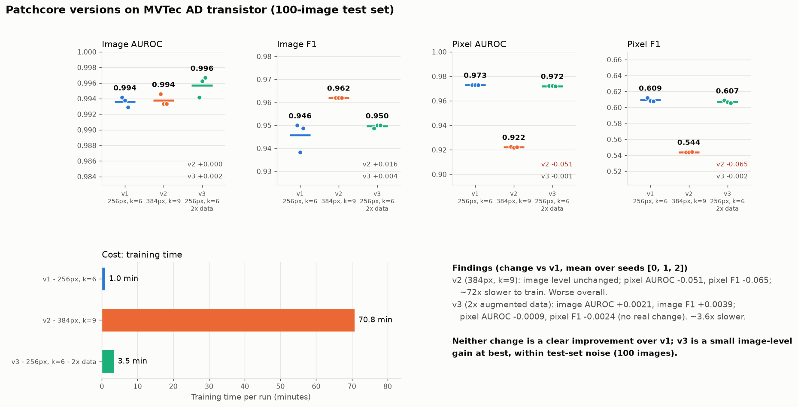

# Anomaly Detection

Visual anomaly detection on the **MVTec AD – transistor** category using [Anomalib](https://github.com/open-edge-platform/anomalib).

## Dataset

The dataset is not included in this repo (the MVTec AD license is CC BY-NC-SA 4.0). Place `transistor.tar.xz` in the project root and extract it:

```bash
mkdir -p data/MVTecAD && tar -xJf transistor.tar.xz -C data/MVTecAD
```

Expected layout:

```
data/MVTecAD/transistor/
├── train/good/            # 213 normal images
├── test/good/             # 60 normal images
├── test/{bent_lead,cut_lead,damaged_case,misplaced}/   # 40 anomalous images
└── ground_truth/{bent_lead,cut_lead,damaged_case,misplaced}/  # pixel masks
```

## Setup

Requires [uv](https://docs.astral.sh/uv/). This creates a Python 3.12 virtual environment with PyTorch (CUDA 13.0 build) and Anomalib:

```bash
uv sync
```

## Project structure

```
configs/                 # Anomalib model / data configs
src/anomaly_detection/   # Project source code
scripts/                 # Training / evaluation / export entry points
notebooks/               # Exploration notebooks
tests/                   # Tests
results/                 # Training outputs (gitignored)
models/                  # Exported models (gitignored)
data/                    # Dataset (gitignored)
```

## Baseline model (v1)

First implementation: **Patchcore** with Anomalib defaults (`num_neighbors=6`), trained on the 213 normal
transistor images with no tuning or optimisation.

| Metric | Value |
|---|---|
| Image AUROC | 0.996 |
| Image F1 | 0.962 |
| Pixel AUROC | 0.973 |
| Pixel F1 | 0.610 |

97/100 test images classified correctly (1 false positive, 2 false negatives). Full breakdown and charts:
[docs/baseline_overview.md](docs/baseline_overview.md).

Patchcore subsamples randomly, so re-training gives slightly different numbers. The weights (~234 MB) are
too large for git; the saved copy lives locally in `models/v1_baseline/` (gitignored).

Reproduce:

```bash
uv run python scripts/prepare_data.py          # extract + validate data
uv run python src/anomaly_detection/training.py   # train, test, export, save figures
uv run python scripts/results_overview.py      # metrics + overview chart
```

## Version comparison (v1, v2, v3)

Each version was trained with 3 seeds and scored on the 100-image test set.

| Version | Setup | Image AUROC | Pixel AUROC | Pixel F1 | Train time |
|---|---|---|---|---|---|
| v1 | 256px, k=6 (baseline) | 0.994 | 0.973 | 0.609 | 1 min |
| v2 | 384px, k=9 | 0.994 | 0.922 | 0.544 | 71 min |
| v3 | 256px, k=6, 2x augmented data | 0.996 | 0.972 | 0.607 | 3.5 min |

Neither v2 nor v3 clearly beats v1. The neighbour count only changes image scores, not pixel metrics
(see [docs/neighbor_sweep.md](docs/neighbor_sweep.md)). Details: [docs/version_comparison.md](docs/version_comparison.md)



Reproduce:

```bash
uv run python scripts/make_augmented_data.py     # builds data/MVTecAD_aug for v3
uv run python scripts/compare_versions.py        # trains v1-v3, 3 seeds each
uv run python scripts/neighbor_sweep.py          # neighbour sweep on v3
uv run python scripts/comparison_overview.py     # overview chart
```
