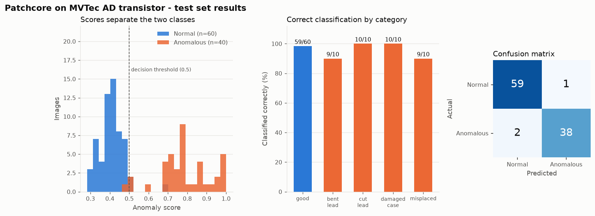
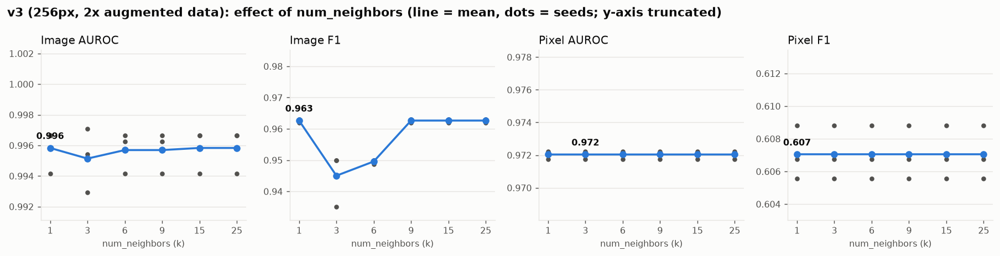

# Anomaly Detection on MVTec AD – Transistor

Visual anomaly detection on the **transistor** category of the [MVTec AD](https://www.mvtec.com/company/research/datasets/mvtec-ad)
dataset, using [Anomalib](https://github.com/open-edge-platform/anomalib) and the **Patchcore** model.

The model is trained **only on images of good transistors**. At test time it has to flag defective ones
(image level) and show *where* the defect is (pixel level). The project builds a baseline (v1), then tests three
ideas for improving it (bigger images, more training data, different neighbour counts) and documents what did
and did not help.


## Contents

- [Dataset and license](#dataset-and-license)
- [Method](#method)
- [Results](#results)
- [Findings](#findings)
- [Limitations](#limitations)
- [Possible next steps](#possible-next-steps)
- [Setup and usage](#setup-and-usage)
- [Project structure](#project-structure)
- [References](#references)

## Dataset and license

The transistor category of **MVTec AD** contains photos of a transistor on a circuit board. It has 213 defect-free
training images, 60 defect-free test images and 40 defective test images (10 per defect type) with pixel-level
ground-truth masks. The four defect types are:

| Defect | Description |
|---|---|
| `bent_lead` | a pin is bent |
| `cut_lead` | a pin is cut |
| `damaged_case` | the transistor body is damaged |
| `misplaced` | the component is displaced or rotated (it can also be completely missing) |

MVTec AD was created by MVTec Software GmbH ([Bergmann et al., CVPR 2019 / IJCV 2021](#references)) and is released
under the **[Creative Commons Attribution-NonCommercial-ShareAlike 4.0 International license (CC BY-NC-SA 4.0)](https://creativecommons.org/licenses/by-nc-sa/4.0/)**.
In short:

- **Attribution**: you must credit MVTec and cite the paper.
- **NonCommercial**: the data may not be used for commercial purposes.
- **ShareAlike**: anything derived from the data must be shared under the same license.

Consequences for this repo:

- **The dataset is not included** and is git-ignored (`data/`, `*.tar.xz`). Download it yourself from the
  [MVTec website](https://www.mvtec.com/company/research/datasets/mvtec-ad) (the per-category `transistor.tar.xz` is enough).
- The augmented copies used for v3 are derived from the dataset, so the same license applies to them. They are generated
  locally into `data/MVTecAD_aug/` and are not committed either.
- The charts under `docs/` contain only metrics, not dataset images.
- Please check the license terms on the MVTec page yourself before reusing anything built on this data.

## Method

**Model: Patchcore** ([Roth et al., CVPR 2022](#references)), as implemented in Anomalib. It needs no gradient
training:

1. Features are extracted from every training image with a pretrained backbone (`wide_resnet50_2`, layers 2 and 3).
2. The patch features of all good images are stored in a *memory bank*, which is reduced to a representative subset
   (10 %) by coreset subsampling.
3. At test time, each patch of a new image is compared with its nearest neighbours in the memory bank. A large distance
   means "unlike anything seen in good images". These distances form the **anomaly map** (pixel level), and their
   maximum gives the **anomaly score** (image level).

**Metrics** (all on the 100-image test set):

- **Image AUROC**: how well the anomaly score separates good from defective images, independent of any threshold.
- **Image F1**: balance of precision and recall for the good/defective decision at the model's threshold.
- **Pixel AUROC / Pixel F1**: the same, but per pixel against the ground-truth defect masks.

Patchcore's coreset subsampling is random, so every experiment was run with **3 seeds** and the mean is reported.

## Results

### Baseline (v1)

Patchcore with Anomalib's defaults (256 px input, 6 neighbours), trained on the 213 good images, with no tuning.
Saved checkpoint, 100 test images:

| | Predicted good | Predicted defective |
|---|---|---|
| **Actually good** | 59 | 1 |
| **Actually defective** | 2 | 38 |

97 of 100 images are classified correctly. Per category: good 59/60, bent lead 9/10, cut lead 10/10,
damaged case 10/10, misplaced 9/10.



The scores separate the classes well: good images score about 0.3–0.5 and defective ones about 0.6–1.0. The three
mistakes sit right next to the decision boundary.

### Comparison of versions

| Version | Setup | Image AUROC | Image F1 | Pixel AUROC | Pixel F1 | Training time |
|---|---|---|---|---|---|---|
| **v1** | 256 px, k = 6 (baseline) | 0.994 | 0.946 | 0.973 | 0.609 | 1 min |
| **v2** | 384 px, k = 9 | 0.994 | 0.962 | 0.922 | 0.544 | 71 min |
| **v3** | 256 px, k = 6, 2× augmented training data | 0.996 | 0.950 | 0.972 | 0.607 | 3.5 min |

Mean over 3 seeds, RTX 3070 (8 GB). Per-seed numbers and standard deviations are in
[docs/version_comparison.md](docs/version_comparison.md). The v1 row is the 3-seed average, so it differs slightly
from the single saved checkpoint shown above.

### Neighbour count (on v3)

Each seed was trained once and then scored with k = 1, 3, 6, 9, 15 and 25 on the same memory bank.

| Metric | Effect of k |
|---|---|
| Image AUROC | flat (0.995–0.996) |
| Image F1 | 0.963 for k = 1, 9, 15, 25; 0.945 at k = 3; 0.950 at k = 6 (a difference of 1–2 images) |
| Pixel AUROC / F1 | **identical for every k** |

Details and chart: [docs/neighbor_sweep.md](docs/neighbor_sweep.md).



## Findings

1. **Patchcore is already very strong on this category.** The unoptimised baseline reaches an image AUROC of about
   0.994 and classifies 97 of 100 test images correctly. The remaining errors are borderline cases.
2. **Moving the decision threshold does not help.** The 0.5 cutoff sits in a narrow gap: the highest good scores
   are 0.499 and the lowest defect scores 0.472–0.508. Lowering it to 0.47 turns 7 good images into false alarms
   (0.45: 12), and raising it to 0.70 misses 7 defects. One good image scores 0.695 and is a false positive at
   almost every threshold.
3. **Bigger images made the model worse (v2).** 384 px with 9 neighbours left image-level results unchanged but cut
   pixel AUROC from 0.973 to 0.922 and pixel F1 from 0.609 to 0.544, and made training about 70× slower (it also
   pushed the 8 GB GPU to its limit). The original hypothesis, that thin leads need higher resolution, was not
   supported. Because the neighbour sweep shows pixel metrics do not depend on k, the drop comes from the image size
   rather than the neighbours. I did not test *why*; one untested explanation is that Anomalib's post-processing
   (smoothing and normalisation) is tuned for 256 px.
4. **More (augmented) training data gave at most a small gain (v3).** Doubling the training set with mild augmented
   copies moved image AUROC by +0.002 and image F1 by +0.004, which is within what 100 test images can resolve, and
   left pixel metrics unchanged, at about 3.6× the training time. Only mild, orientation-preserving augmentations
   were used (brightness/contrast, ±2 % shift, ±3° rotation, light blur), because a flipped or rotated transistor
   resembles the `misplaced` defect.
5. **The neighbour count is not a useful lever.** It only changes how the image score is computed (not the anomaly
   maps), and the effect on image metrics is at the level of 1–2 images. Values of 9 or higher give the best F1 here.
6. **Overall: v1 is the best trade-off.** None of the tested changes clearly beat it, and the baseline is already
   close to the ceiling of this model on this data.

## Limitations

- **Small test set.** 100 images means one image is 1 % of accuracy, so differences of a few thousandths in AUROC
  or one image in F1 are not meaningful. The three seeds only capture Patchcore's own randomness, not the choice
  of test images.
- **No validation split.** All comparisons were made on the test set, so the reported numbers are somewhat
  optimistic as an estimate of performance on new data.
- **One category.** Results for the transistor may not transfer to other MVTec AD categories or real production data.
- **Not tested.** Other backbones and layers, the coreset ratio, pixel-threshold tuning and other models (for
  example PaDiM or EfficientAd) were not tried.
- **Windows-specific.** Data loading uses `num_workers=0` because multi-worker loading crashed silently on Windows.

## Possible next steps

- Tune the **pixel threshold** (pixel F1 of about 0.61 is the weakest number; pixel AUROC is high, so the model
  finds defects but the thresholded masks match the ground truth loosely).
- Try the **coreset sampling ratio** and the **feature layers** at 256 px, where runs take about a minute.
- Try other **backbones**; a different model is expected to help little since Patchcore is a strong fit for this task.
- Inspect the specific misclassified images (for example the good image scoring 0.695) to find a systematic cause.
- Add a **validation split** so tuning no longer touches the test set.
- Try Anomalib's other models for comparison, and export (for example OpenVINO) if inference speed matters.

## Setup and usage

Requires [uv](https://docs.astral.sh/uv/) and an NVIDIA GPU. The environment uses Python 3.12 with the CUDA 13.0 build
of PyTorch.

```bash
uv sync
```

Place `transistor.tar.xz` (downloaded from MVTec, see [Dataset and license](#dataset-and-license)) in the project
root, then:

```bash
uv run python scripts/prepare_data.py              # extract, validate layout, smoke-test the datamodule
uv run python src/anomaly_detection/training.py    # train v1, test, export model, save prediction figures
uv run python scripts/results_overview.py          # metrics, confusion matrix and overview chart for v1
```

To reproduce the comparison:

```bash
uv run python scripts/make_augmented_data.py      # builds data/MVTecAD_aug (v3 training data)
uv run python scripts/compare_versions.py         # trains v1, v2, v3 with 3 seeds each (v2 takes ~70 min per seed)
uv run python scripts/neighbor_sweep.py           # neighbour sweep on v3
uv run python scripts/comparison_overview.py      # overview chart
```

Model weights (~234 MB each) are too large for git and are saved locally under `models/` (git-ignored).
Training outputs go to `results/` (git-ignored); the summaries kept in the repo are in `docs/`.

## Project structure

```
src/anomaly_detection/
  training.py            # v1: train, test, export, prediction figures
  experiment.py          # shared train + evaluate helpers (versions, seeds, neighbour sweep)
scripts/
  prepare_data.py        # extract and validate the dataset, build the Anomalib datamodule
  make_augmented_data.py # create the augmented training set for v3
  compare_versions.py    # run v1/v2/v3 with several seeds and tabulate results
  comparison_overview.py # one-page comparison chart
  neighbor_sweep.py      # neighbour-count sweep
  results_overview.py    # v1 metrics, per-category results, confusion matrix
docs/                    # committed result summaries (tables, charts, raw JSON)
notebooks/notes.ipynb    # project notes: defect types and ideas for improvement
data/  results/  models/ # dataset, training outputs, saved models (git-ignored)
```

## References

- P. Bergmann, M. Fauser, D. Sattlegger, C. Steger. *MVTec AD – A Comprehensive Real-World Dataset for Unsupervised
  Anomaly Detection.* CVPR 2019. Extended version: *The MVTec Anomaly Detection Dataset: A Comprehensive Real-World
  Dataset for Unsupervised Anomaly Detection.* International Journal of Computer Vision, 2021.
  Dataset page: <https://www.mvtec.com/company/research/datasets/mvtec-ad>
- K. Roth, L. Pemula, J. Zepeda, B. Schölkopf, T. Brox, P. Gehler. *Towards Total Recall in Industrial Anomaly
  Detection.* CVPR 2022 (Patchcore).
- [Anomalib](https://github.com/open-edge-platform/anomalib), the library providing the Patchcore implementation and
  data modules.
- License of the dataset: [CC BY-NC-SA 4.0](https://creativecommons.org/licenses/by-nc-sa/4.0/).
