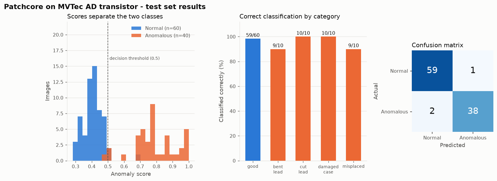

# Patchcore - transistor results

Checkpoint: `results\Patchcore\MVTecAD\transistor\latest\weights\lightning\model.ckpt`
Test set: 100 images (60 normal, 40 anomalous)

## Metrics

| Metric | Value |
|---|---|
| image_AUROC | 0.9958 |
| image_F1Score | 0.9620 |
| pixel_AUROC | 0.9727 |
| pixel_F1Score | 0.6095 |
| image accuracy | 0.9700 |
| image precision | 0.9744 |
| image recall | 0.9500 |

## Confusion matrix

| | Predicted normal | Predicted anomalous |
|---|---|---|
| **Actual normal** | 59 | 1 |
| **Actual anomalous** | 2 | 38 |

## Per category

| Category | Correct | Mean score | Max score |
|---|---|---|---|
| good | 59/60 | 0.408 | 0.695 |
| bent_lead | 9/10 | 0.806 | 0.977 |
| cut_lead | 10/10 | 0.768 | 0.945 |
| damaged_case | 10/10 | 0.799 | 1.000 |
| misplaced | 9/10 | 0.784 | 1.000 |

