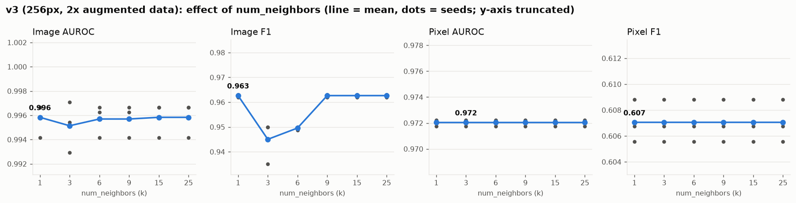

# v3 neighbour sweep

Mean ± std over seeds [0, 1, 2]; each seed trained once, scored with every k.

| k | Image AUROC | Image F1 | Pixel AUROC | Pixel F1 |
|---|---|---|---|---|
| 1 | 0.9958 ± 0.0012 | 0.9627 ± 0.0004 | 0.9720 ± 0.0002 | 0.6070 ± 0.0013 |
| 3 | 0.9951 ± 0.0017 | 0.9450 ± 0.0070 | 0.9720 ± 0.0002 | 0.6070 ± 0.0013 |
| 6 | 0.9957 ± 0.0011 | 0.9496 ± 0.0006 | 0.9720 ± 0.0002 | 0.6070 ± 0.0013 |
| 9 | 0.9957 ± 0.0011 | 0.9627 ± 0.0004 | 0.9720 ± 0.0002 | 0.6070 ± 0.0013 |
| 15 | 0.9958 ± 0.0012 | 0.9627 ± 0.0004 | 0.9720 ± 0.0002 | 0.6070 ± 0.0013 |
| 25 | 0.9958 ± 0.0012 | 0.9627 ± 0.0004 | 0.9720 ± 0.0002 | 0.6070 ± 0.0013 |

