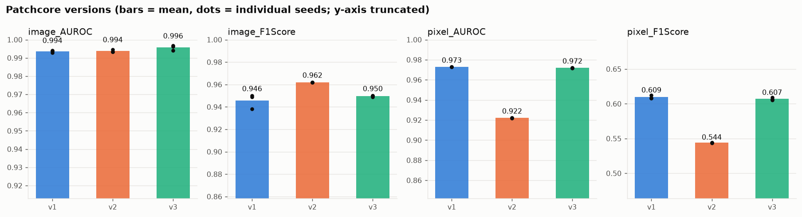

# Patchcore version comparison

Mean ± std over seeds [0, 1, 2] on the 100-image transistor test set.

| Version | Image size | Neighbours | Training data |
|---|---|---|---|
| v1_baseline | 256px | 6 | data/MVTecAD |
| v2_384px_k9 | 384px | 9 | data/MVTecAD |
| v3_aug2x | 256px | 6 | data/MVTecAD_aug |

| Metric | v1_baseline | v2_384px_k9 | v3_aug2x | v2 - v1 | v3 - v1 |
|---|---|---|---|---|---|
| image_AUROC | 0.9936 ± 0.0005 | 0.9937 ± 0.0006 | 0.9957 ± 0.0011 | +0.0001 | +0.0021 |
| image_F1Score | 0.9457 ± 0.0053 | 0.9620 ± 0.0000 | 0.9496 ± 0.0006 | +0.0164 | +0.0039 |
| pixel_AUROC | 0.9730 ± 0.0001 | 0.9222 ± 0.0002 | 0.9720 ± 0.0002 | -0.0508 | -0.0009 |
| pixel_F1Score | 0.6095 ± 0.0020 | 0.5440 ± 0.0003 | 0.6070 ± 0.0013 | -0.0655 | -0.0024 |
| fit_s | 58.7157 ± 0.4407 | 4249.3686 ± 315.0766 | 208.9006 ± 0.7344 | +4190.6529 | +150.1849 |
| test_s | 11.1386 ± 0.1518 | 16.6421 ± 0.1617 | 11.6259 ± 0.0243 | +5.5034 | +0.4873 |

Per-seed values:

| Version | Seed | image_AUROC | image_F1Score | pixel_AUROC | pixel_F1Score |
|---|---|---|---|---|---|
| v1_baseline | 0 | 0.9942 | 0.9500 | 0.9731 | 0.6122 |
| v1_baseline | 1 | 0.9937 | 0.9383 | 0.9729 | 0.6086 |
| v1_baseline | 2 | 0.9929 | 0.9487 | 0.9730 | 0.6076 |
| v2_384px_k9 | 0 | 0.9946 | 0.9620 | 0.9224 | 0.5438 |
| v2_384px_k9 | 1 | 0.9933 | 0.9620 | 0.9219 | 0.5438 |
| v2_384px_k9 | 2 | 0.9933 | 0.9620 | 0.9223 | 0.5444 |
| v3_aug2x | 0 | 0.9942 | 0.9487 | 0.9721 | 0.6088 |
| v3_aug2x | 1 | 0.9962 | 0.9500 | 0.9722 | 0.6067 |
| v3_aug2x | 2 | 0.9967 | 0.9500 | 0.9717 | 0.6056 |

